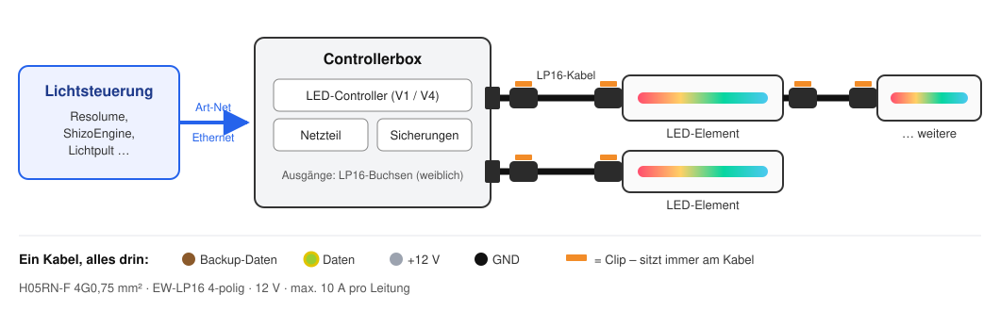

# L300 LED-Technik – Standard & Controller

Hier dokumentieren wir, wie wir bei **L300** unsere LED-Deko bauen und verkabeln – und die **LED-Controller**, die wir dafür entwickelt haben.

Zwei Dinge stecken in diesem Repo:

1. **Unser Verkabelungsstandard** – damit jedes Kabel an jede Box und jedes LED-Element passt.
2. **Unsere LED-Controller** – offen gebaut, sodass sie auch ohne unseren Standard funktionieren.

## Der L300-Standard auf einen Blick

| | |
|---|---|
| **Kabel** | H05RN-F 4G0,75 mm² – 4 Adern: Backup-Daten, Daten, +12 V, GND |
| **Stecker** | EW-LP16, 4-polig, IP68 – **Clips immer am Kabel**, Geräte haben Buchsen ohne Clip |
| **Richtung** | Ausgang = weiblich, Eingang = männlich |
| **Spannung** | 12 V |
| **LEDs** | Empfehlung: WS2815 (12 V, mit Backup-Datenleitung) – andere Typen möglich |
| **Ansteuerung** | Art-Net über Ethernet |

> **Fest** sind bei uns Kabel und Stecker – daran hängt, dass alles zusammenpasst.
> **Offen** sind die LEDs: Solange sie am 4-poligen LP16-Anschluss hängen und zur Spannung passen, kann jedes Element seine eigenen LEDs haben.

## Dokumentation

**Standard & Material**

| Thema | Was steht drin |
|---|---|
| 🔌 [**Stecker (LP16)**](docs/stecker-lp16.md) | Welcher Stecker wohin, mit oder ohne Clip, Bestell-Links, Pinbelegung |
| 🧵 [**Kabel & Verschraubungen**](docs/kabel.md) | Kabeltyp, Aderfarben, passende PG-Verschraubungen |
| 💡 [**LEDs**](docs/leds.md) | Welche LED-Typen gehen, wann welche sinnvoll ist, unser Standard WS2815 |
| ⚡ [**Stromversorgung & Absicherung**](docs/stromversorgung.md) | Leistung berechnen, Spannungsabfall & Kabellängen, Netzteile, Sicherungen |

**Bauen & Betreiben**

| Thema | Was steht drin |
|---|---|
| 🛠️ [**Kabel konfektionieren & prüfen**](docs/kabel-konfektionieren.md) | LP16-Kabel Schritt für Schritt löten und durchmessen |
| 📦 [**Stückliste Controllerbox V1**](docs/stueckliste-controllerbox-v1.md) | Alle Teile mit Links und Preisen |
| 🌐 [**Art-Net einrichten**](docs/art-net.md) | IP-Adressen, Universen, Software-Einrichtung |
| 🌧️ [**Draußen & Nässe**](docs/draussen.md) | Schutzarten, wasserdichte Netzteile, Checkliste vor dem Aufbau |
| 🩺 [**Fehlersuche**](docs/fehlersuche.md) | Dunkel, flackert, falsche Farben, Sicherung fliegt – was tun? |

**Controller**

| Thema | Was steht drin |
|---|---|
| 🎛️ [**Controller V4 – ESP32-P4-NANO**](docs/controller-v4-p4-nano.md) | Der neue Controller (in Entwicklung): bis 16 Ausgänge, 5/12/24 V, WLED-Option |
| 🎛️ [**Controller V1 – WT32-ETH01**](docs/controller-v1-wt32.md) | Der Controller in unseren aktuellen Boxen: 4 Ausgänge, Art-Net |

## Die LED-Controller

Die Controller sind **nicht an unseren Standard gebunden**. Sie laufen mit beliebigen einadrigen RGB-Pixel-LEDs (WS281x-Protokoll) und – beim V4 – mit 5, 12 oder 24 V. Unser Standard ist nur *eine* Art, sie zu benutzen.

Die Firmware kommt von [shizotech](https://github.com/shizotech/esp32_p4_nano_led): eine eigene Alternative zu WLED mit Webinterface, Art-Net, Audioreaktivität und frei programmierbaren Effekten (Shizoscript).

| | Controller V1 | Controller V4 |
|---|---|---|
| Status | im Einsatz | 🚧 in Entwicklung |
| Mikrocontroller | ESP32 WT32-ETH01 | ESP32-P4-NANO |
| Ausgänge | 4 | 4, erweiterbar bis 16 |
| Absicherung | extern, 5 A pro Ausgang | auf der Platine, bis 10 A pro Ausgang |
| Spannung | 12 V | 5 / 12 / 24 V |
| Netzwerk | Ethernet | Ethernet + WLAN |
| Firmware | ältere Shizo-Firmware | aktuelle Shizo-Firmware, optional WLED |
