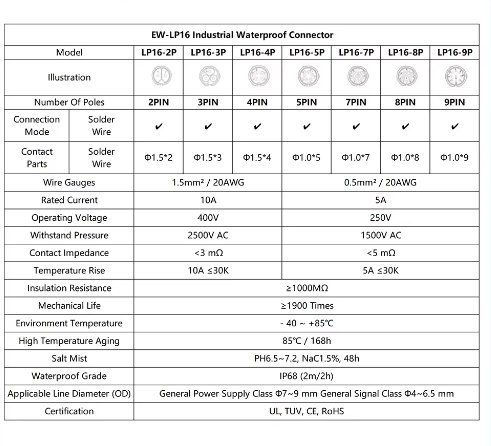
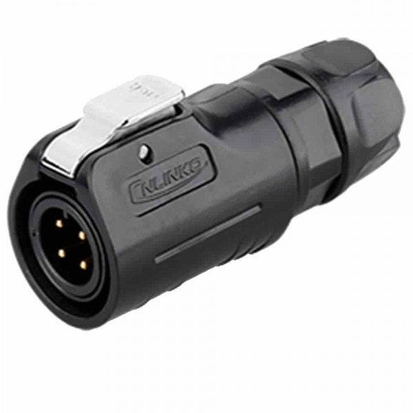
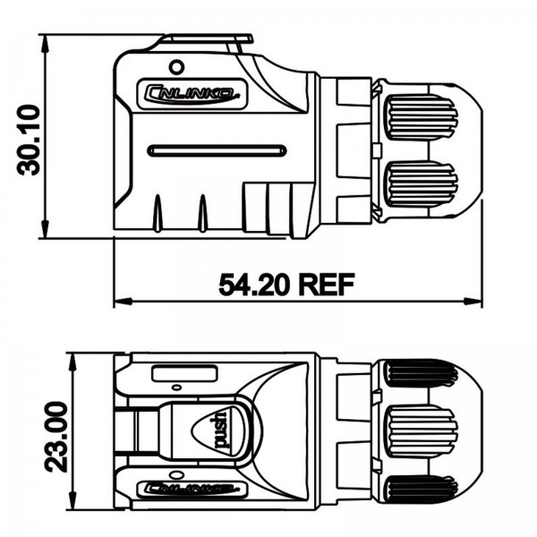
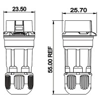
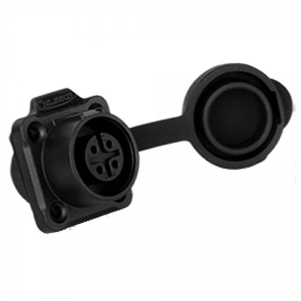
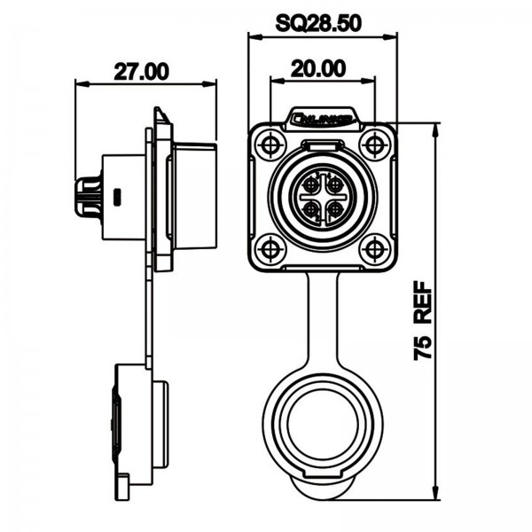
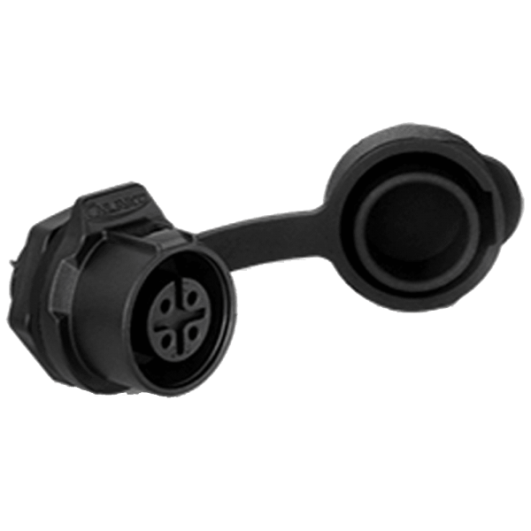
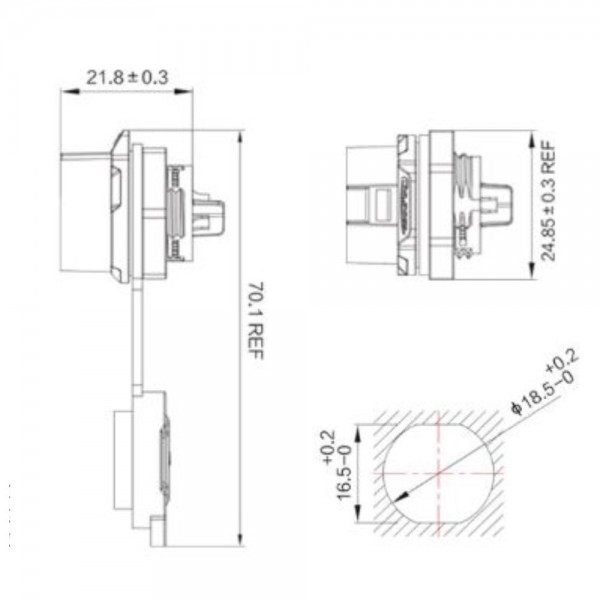

# Allgemeine-LED-Technik-Dokumentation
Allgemeine LED-Technik Dokumentation

Hier wird der Standard beschrieben den wir für unsere 12V WS2815 LED Technik verwenden

LEDs:
  Protokoll: WS2815
  Spannung: 12V
  Max Stromstärke pro LED: 15mA

  [WS-2815](https://de.aliexpress.com/item/1005004289391906.html?spm=a2g0o.productlist.main.1.440foJeeoJeevz&algo_pvid=3e679300-23e6-4f53-8256-4e59664eea96&algo_exp_id=3e679300-23e6-4f53-8256-4e59664eea96-0&pdp_npi=4%40dis%21EUR%2119.39%219.89%21%21%21147.90%2175.44%21%4021039cba17276415190216883e30a9%2112000038338767396%21sea%21DE%212975965101%21X&curPageLogUid=op9JRbgbQs11&utparam-url=scene%3Asearch%7Cquery_from%3A)
  

Controller:
  Unserer Standart soll es sein einen [ESP32 WT-32]( https://de.aliexpress.com/item/1005006485369425.html?spm=a2g0o.productlist.main.3.67681b00wzVink&algo_pvid=4857ddb3-a06e-4533-b9fd-954690b4cf02&algo_exp_id=4857ddb3-a06e-4533-b9fd-954690b4cf02-1&pdp_npi=4%40dis%21EUR%219.99%219.99%21%21%2176.20%2176.20%21%402103853f17276533435462307e9603%2112000037380725559%21sea%21DE%212975965101%21X&curPageLogUid=yGFK2UEkQkuR&utparam-url=scene%3Asearch%7Cquery_from%3A) zunutzen, dieser hat direkt einen Ethernet-Anschluss der direkt auf den Mikrocontroller gehen.
   

  Angestrebt werden 60FPS, daher ergeben sich folgende Limitierungen:
    Max Ausgänge: 4
    Max Universen pro Ausgang: 2
    Max LEDs pro Ausgang: 340

  Wenn keine LEDs parallel geschalten wurden, ergeben sich dadurch folgende Stromstärken und Leistungen:
    Max Stromstärke pro Ausgang: 4.08A
    Max Stromstärke pro Controller: 16.32A
    Max Watt pro Controller: 195.84W

  Daher macht es Sinn in eine Controllerbox ein 12V 200W Netzteil zu verbauen. (siehe Netzteil)
  Für Installationen mit eigenem Controller können natürlich auch Netzteile mit angepasster niedrigerer Leistung verwendet werden.

Netzteil:

    200W Netzteil:
    https://a.aliexpress.com/_Ex9F1f7

  Sicherung:
    Jeder Ausgang sollte mit einem 2 Poligen DC Leitungsschutzschalter 6A ausgerüstet werden, um gegen Kurzschluss zu sichern.
        
    https://de.aliexpress.com/item/1005007096326577.html?spm=a2g0o.cart.0.0.7d7a4ae4YPx434&mp=1&gatewayAdapt=glo2deu
    
Kabel:
  Das dünnste für unsere Stromstärken benötigte und gleichzeitig sehr hochwertige Kabel ist das:
  
  H05rn-f 4Gx0,75mm^2:
    Max Stromstärke: 10A
    Kabelaußendurchmesser: 6.80-8.80mm
    
Stecker:
  !!!Ausgang ist immer weiblich und Eingang ist immer männlich!!!

  Der passende Stecker zu unseren Anforderungen ist der:

  EW-LP16 - 4 Polig:
  
  Kabelaußendurchmesser: 7 - 9mm
    
  Max Stromstärke: 10A

  

  

  Stecker männlich:
  
  
  
  

  
  Stecker weiblich:
  
  
    
  

    

  Buchse männlich eckig:

  Buchse weiblich eckig:
  
  
  
  

  

  Buchse männlich rund:

  Buchse weiblich rund:
  
  
  
  

  

  Aliexpress Links:
  
  [Set mit männlichen und weiblichen Stecker: 5,29€](https://de.aliexpress.com/item/1005007372672331.html?spm=a2g0o.cart.0.0.3ce54ae4bq4xFz&mp=1&gatewayAdapt=glo2deu)

  [Set mit männlichen Stecker und weiblicher eckiger Buchse: 4,99€](https://de.aliexpress.com/item/1005006403420945.html?spm=a2g0o.cart.0.0.3ce54ae4bq4xFz&mp=1&gatewayAdapt=glo2deu)

  [Set mit männlicher Stecker und weiblicher runder Buchse: 4,99€](https://de.aliexpress.com/item/1005006403606099.html?spm=a2g0o.cart.0.0.3ce54ae4bq4xFz&mp=1&gatewayAdapt=glo2deu)

  [Set mit männlicher eckiger Buchse und weiblichen Stecker: 4,69](https://de.aliexpress.com/item/1005007399437780.html?spm=a2g0o.productlist.main.49.25e63291h0eGiG&algo_pvid=ac3d22fd-3740-44ff-9a8a-38c692df7b94&algo_exp_id=ac3d22fd-3740-44ff-9a8a-38c692df7b94-24&pdp_npi=4%40dis%21EUR%215.85%214.39%21%21%216.37%214.78%21%40211b6d3517277699040405588e3aa1%2112000040585661988%21sea%21DE%212975965101%21X&curPageLogUid=zY6VKCu4rxaI&utparam-url=scene%3Asearch%7Cquery_from%3A)

  [Set mit männlicher runder Buchse und weiblichen Stecker: 4,89€](https://de.aliexpress.com/item/1005006774475512.html?spm=a2g0o.productlist.main.29.25e63291h0eGiG&algo_pvid=ac3d22fd-3740-44ff-9a8a-38c692df7b94&algo_exp_id=ac3d22fd-3740-44ff-9a8a-38c692df7b94-14&pdp_npi=4%40dis%21EUR%215.45%214.09%21%21%215.93%214.45%21%40211b6d3517277699040405588e3aa1%2112000038260060488%21sea%21DE%212975965101%21X&curPageLogUid=h7mr97sI2m7O&utparam-url=scene%3Asearch%7Cquery_from%3A)
  
  SP17 - 4 Polig
    Kabelaußendurchmesser: 6 - 10mm
    Max Stromsträke: 6A

    https://www.liveelectronicsgroup.com/wp-content/uploads/2020/12/Weipu-SP17-Catalogue.pdf

    Set mit weiblicher Buchse und männlichen Stecker:
      https://de.aliexpress.com/item/1005005484121525.html?pdp_npi=4%40pre%21EUR%21%E2%82%AC%203%2C05%21%21%E2%82%AC%203%2C05%21%213.33%213.33%21%402103868a17276541307817253ed080%2112000033266215813%21sh%21DE%212975965101%21X&spm=a2g0o.store_pc_allItems_or_groupList.new_all_items_2007523495057.1005005484121525&gatewayAdapt=glo2deu

    Set mit männlicher Buchse und weiblichen Stecker:
      https://de.aliexpress.com/item/1005004863010680.html?spm=a2g0o.productlist.main.51.25555HbO5HbOki&algo_pvid=267e9496-9277-46f9-83e4-3e182ae7d5bc&algo_exp_id=267e9496-9277-46f9-83e4-3e182ae7d5bc-25&pdp_npi=4%40dis%21EUR%216.96%215.29%21%21%217.59%215.77%21%40211b650017276647658706316ea033%2112000030793657024%21sea%21DE%212975965101%21X&curPageLogUid=ngGGSEB1S1Cw&utparam-url=scene%3Asearch%7Cquery_from%3A

      Set mit weiblichen Stecker und männlichen Stecker:
        https://de.aliexpress.com/item/1005005484687688.html?pdp_npi=4%40pre%21EUR%21%E2%82%AC%203%2C69%21%21%E2%82%AC%203%2C69%21%214.02%214.02%21%402103868a17276542036097503ed080%2112000033267690028%21sh%21DE%212975965101%21X&spm=a2g0o.store_pc_allItems_or_groupList.new_all_items_2007523495057.1005005484687688&gatewayAdapt=glo2deu

Verschraubungen:
  Passende Verschraubungen für unseren Kabelausßendurchmesser sind:
    
    PG11:
      Kabelaußendurchmesser: 5-10mm
      Gewinde: M18x1,5

    PG13:
      Kabelaußendruchmesser: 6-11mm
      Gewinde: M20x1,5

