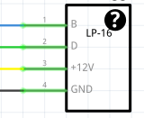

# Allgemeine-LED-Technik-Dokumentation

Hier wird der Standard beschrieben den wir für unsere 12V WS2815 LED Technik verwenden

## LEDs:
  Protokoll: WS2815 
  Spannung: 12V 
  Max Stromstärke pro LED: 15mA 

  [WS-2815](https://de.aliexpress.com/item/1005004289391906.html?spm=a2g0o.productlist.main.1.440foJeeoJeevz&algo_pvid=3e679300-23e6-4f53-8256-4e59664eea96&algo_exp_id=3e679300-23e6-4f53-8256-4e59664eea96-0&pdp_npi=4%40dis%21EUR%2119.39%219.89%21%21%21147.90%2175.44%21%4021039cba17276415190216883e30a9%2112000038338767396%21sea%21DE%212975965101%21X&curPageLogUid=op9JRbgbQs11&utparam-url=scene%3Asearch%7Cquery_from%3A)
  

## Controller:
  Unserer Standart soll es sein einen [ESP32 WT-32]( https://de.aliexpress.com/item/1005006485369425.html?spm=a2g0o.productlist.main.3.67681b00wzVink&algo_pvid=4857ddb3-a06e-4533-b9fd-954690b4cf02&algo_exp_id=4857ddb3-a06e-4533-b9fd-954690b4cf02-1&pdp_npi=4%40dis%21EUR%219.99%219.99%21%21%2176.20%2176.20%21%402103853f17276533435462307e9603%2112000037380725559%21sea%21DE%212975965101%21X&curPageLogUid=yGFK2UEkQkuR&utparam-url=scene%3Asearch%7Cquery_from%3A) zunutzen, dieser hat direkt einen Ethernet-Anschluss der direkt auf den Mikrocontroller gehen.
   

  Angestrebt werden 60FPS, daher ergeben sich folgende Limitierungen: 
    Max Ausgänge: 4 
    Max Universen pro Ausgang: 2 
    Max LEDs pro Ausgang: 340 

  Wenn keine LEDs parallel geschalten wurden, ergeben sich dadurch folgende Stromstärken und Leistungen: 
    Max Stromstärke pro Ausgang: 4.08A 
    Max Stromstärke pro Controller: 16.32A 
    Max Watt pro Controller: 195.84W 

  Daher macht es Sinn in eine Controllerbox ein 12V 200W Netzteil zu verbauen. (siehe Netzteil) 
  Für Installationen mit eigenem Controller können natürlich auch Netzteile mit angepasster niedrigerer Leistung verwendet werden.

## Netzteil:

    200W Netzteil:
    https://a.aliexpress.com/_Ex9F1f7

## Sicherung: 

Für Controllerplatine V1:

https://www.amazon.de/dp/B0CL9L8JQP?ref=ppx_yo2ov_dt_b_fed_asin_title

https://www.amazon.de/dp/B0CG8R1CNY?ref=ppx_yo2ov_dt_b_fed_asin_title
   
    
## Kabel: 
  Das dünnste für unsere Stromstärken benötigte und gleichzeitig sehr hochwertige Kabel ist das:
  
  H05rn-f 4Gx0,75mm^2: 
    Max Stromstärke: 10A 
    Kabelaußendurchmesser: 6.80-8.80mm 

https://www.etoh24.de/diverse-h05rn-f-4g0-75mm2-schwarz-schnittlaenge.html?from=g_merchant-kabel&gad_source=1&gclid=CjwKCAjw9eO3BhBNEiwAoc0-jYx7MpJ9fFhayBmVVZVrlFNip4jZDGn0BexgIYFV-p3qBQM5n5UEcxoCvqAQAvD_BwE
    
## Stecker: 
  !!!Ausgang ist immer weiblich und Eingang ist immer männlich!!! 

  Der passende Stecker zu unseren Anforderungen ist der:

  ### EW-LP16 - 4 Polig:
  
  Kabelaußendurchmesser: 7 - 9mm
    
  Max Stromstärke: 10A

### Clips müssen immer auf Kabelseite sein!
  Aliexpress Links:
  
  [männlicher Stecker](https://de.aliexpress.com/item/1005006403420945.html?spm=a2g0o.cart.0.0.3ce54ae4bq4xFz&mp=1&gatewayAdapt=glo2deu)

  [weiblicher Stecker](https://de.aliexpress.com/item/1005006674703918.html?spm=a2g0o.order_list.order_list_main.12.17d95c5flbU96e&gatewayAdapt=glo2deu)

  [männliche eckige Buchse](https://de.aliexpress.com/item/1005007399437780.html?spm=a2g0o.productlist.main.49.25e63291h0eGiG&algo_pvid=ac3d22fd-3740-44ff-9a8a-38c692df7b94&algo_exp_id=ac3d22fd-3740-44ff-9a8a-38c692df7b94-24&pdp_npi=4%40dis%21EUR%215.85%214.39%21%21%216.37%214.78%21%40211b6d3517277699040405588e3aa1%2112000040585661988%21sea%21DE%212975965101%21X&curPageLogUid=zY6VKCu4rxaI&utparam-url=scene%3Asearch%7Cquery_from%3A)
  
  [weibliche eckige Buchse:](https://de.aliexpress.com/item/1005006403420945.html?spm=a2g0o.cart.0.0.3ce54ae4bq4xFz&mp=1&gatewayAdapt=glo2deu)

  [weibliche runde Buchse:](https://de.aliexpress.com/item/1005006403606099.html?spm=a2g0o.cart.0.0.3ce54ae4bq4xFz&mp=1&gatewayAdapt=glo2deu)

  [männlicher runde Buchse](https://de.aliexpress.com/item/1005006674703918.html?spm=a2g0o.order_list.order_list_main.12.17d95c5flbU96e&gatewayAdapt=glo2deu)

Die Pinbelegung sieht dabei wie folgt aus:

am H05rn-f 4Gx0,75mm^2 empfehlt sich folgende Belegung:

Pin 1 - Backup - Braun 
Pin 2 - Data   - Gelbgrün 
Pin 3 - +12V   - Grau 
Pin 4 -  GND   - Schwarz 
  
## Verschraubungen: 
  Passende Verschraubungen für unseren Kabelausßendurchmesser sind: 
   
    PG11: 
      Kabelaußendurchmesser: 5-10mm 
      Gewinde: M18x1,5 
 
    PG13: 
      Kabelaußendruchmesser: 6-11mm 
      Gewinde: M20x1,5 

