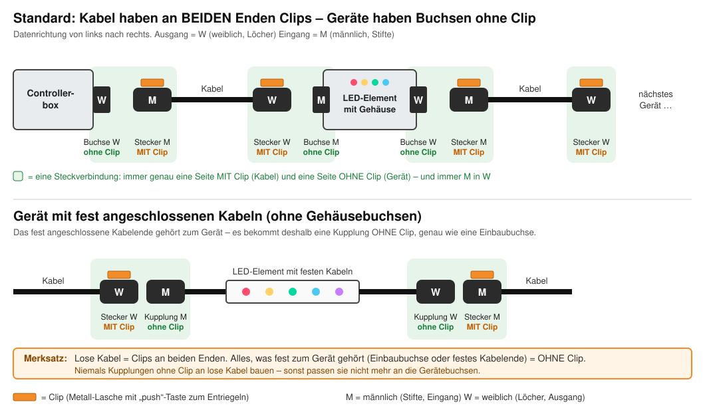
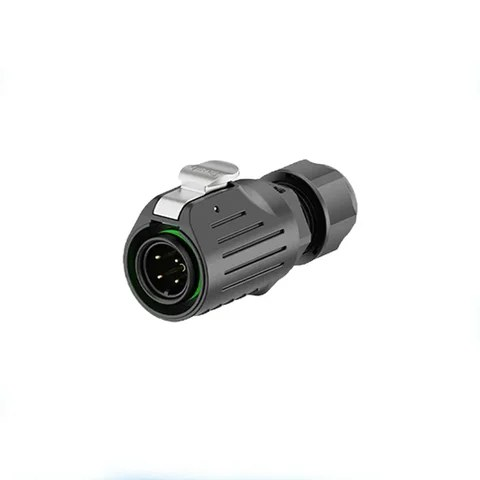
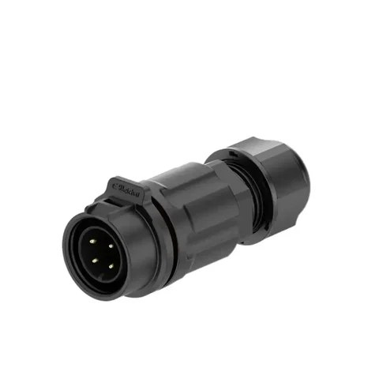
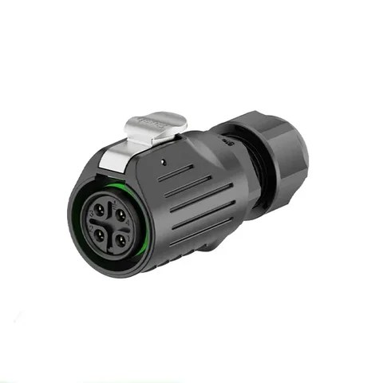
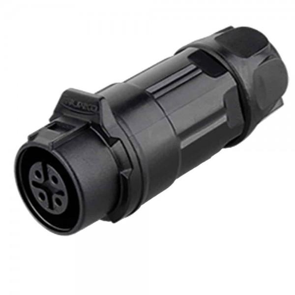
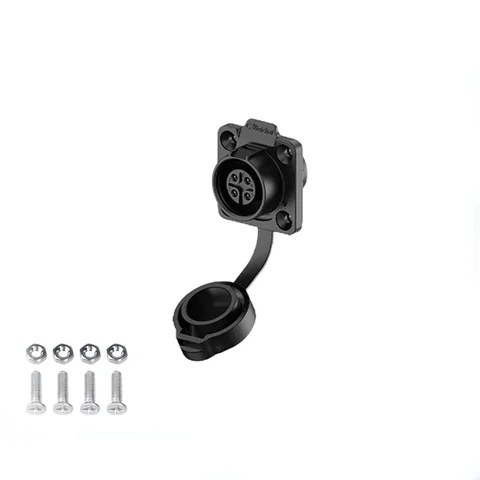
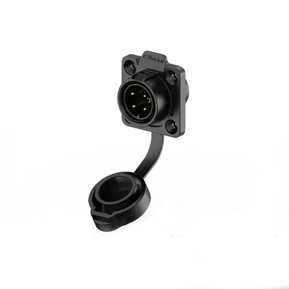
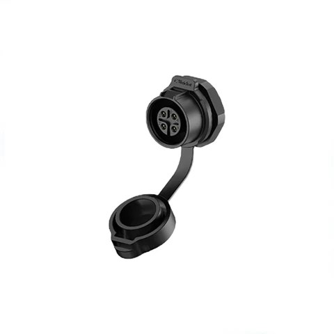
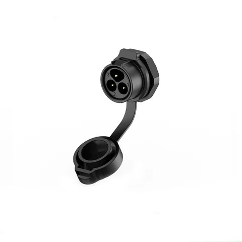
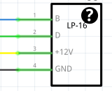

[← Übersicht](../README.md)

# Stecker – EW-LP16 (4-polig)

Wir verwenden durchgehend den **EW-LP16, 4-polig** (M16, IP68, Lötanschluss, Kunststoffgehäuse).

| | |
|---|---|
| Max. Stromstärke | 10 A |
| Kabelaußendurchmesser | 7 – 9 mm (passt zu unserem [Kabel H05RN-F 4G0,75](kabel.md)) |
| Hersteller / Shop | [Power Signal Date Connector Store (AliExpress)](https://de.aliexpress.com/store/1102181980) – **alle Teile unten sind aus diesem Shop** |

## Die Regeln – bitte vor jeder Bestellung lesen!

1. **Ausgang ist immer weiblich (W, Löcher), Eingang ist immer männlich (M, Stifte).**
2. **Clips sind immer am Kabel – an BEIDEN Enden:** jedes lose Kabel hat einen **Stecker männlich MIT Clip** und einen **Stecker weiblich MIT Clip**.
3. **Alles, was fest zum Gerät gehört, hat KEINEN Clip:** Einbaubuchsen am Gehäuse (männlich am Eingang, weiblich am Ausgang) – und auch Kupplungen an fest angeschlossenen Gerätekabeln.

Warum? Jede Steckverbindung braucht genau **eine Seite MIT Clip und eine Seite OHNE Clip**. Clip + Clip rastet nicht ein, ohne + ohne hält nicht.
Weil alle Kabel Clips haben, müssen alle Geräte-Anschlüsse ohne Clip sein – dann passt jedes Kabel an jedes Gerät.

## Woran erkenne ich den Clip?

Der Clip ist die **silberne Metall-Lasche mit „push“-Taste** oben auf dem Stecker. Zum Lösen draufdrücken und abziehen.
Das Gegenstück ohne Clip hat an der Stelle nur eine kleine Kunststoff-Nase, in die der Clip einrastet.

| | MIT Clip (für lose Kabel) | OHNE Clip (nur für Geräte) |
|---|:---:|:---:|
| **männlich** |  |  |
| **weiblich** |  |  |
| | Metall-Lasche oben → rastet ein | nur Rastnase → nimmt den Clip auf |

> 💡 **Lesehilfe für den Shop:** Dort heißt es bei allen Teilen **„Plug“ = mit Clip** und **„Socket“ = ohne Clip**.
> Immer **(P) = Kunststoff** nehmen, (M) ist die Metallversion.

## Teileübersicht

Die Shop-Links sind Sammelangebote mit mehreren Varianten – **bei der Bestellung unbedingt die angegebene Variante auswählen!**

### Für lose Kabel – immer MIT Clip

| Bild | Teil | Clip | Wofür | Link + Variante |
|:---:|---|:---:|---|---|
|  | **Stecker männlich** | ✅ MIT | Anfang jedes Kabels (geht in einen Ausgang) | [Link](https://de.aliexpress.com/item/1005006403420945.html) – Variante **„4 Pin male Plug“** |
|  | **Stecker weiblich** | ✅ MIT | Ende jedes Kabels (geht in einen Eingang) | [Link](https://de.aliexpress.com/item/1005007946297249.html) – Variante **„4 Pin Female Plug“** |

### Für Geräte – Einbaubuchsen, immer OHNE Clip

| Bild | Teil | Montage | Wofür | Link + Variante |
|:---:|---|---|---|---|
|  | **Buchse weiblich, eckig** | 4 Schrauben (liegen bei) | Ausgänge (Controllerbox, LED-Element) | [Link](https://de.aliexpress.com/item/1005006403420945.html) – Variante **„4 Pin female socket“** |
|  | **Buchse männlich, eckig** | 4 Schrauben | Eingänge (LED-Element) | [Link](https://de.aliexpress.com/item/1005007946297249.html) – Variante **„4 Pin male socket“** |
|  | **Buchse weiblich, rund** | Mutter (Rundloch) | Ausgänge (Controllerbox, LED-Element) | [Link](https://de.aliexpress.com/item/1005009884344833.html) – Farbe **„Female socket nut(P)“** + Pins **„4Pin“** |
|  | **Buchse männlich, rund** | Mutter (Rundloch) | Eingänge (LED-Element) | [Link](https://de.aliexpress.com/item/1005009884344833.html) – Farbe **„Male socket nut(P)“** + Pins **„4Pin“** *(Produktbild zeigt 3-polig)* |

### Für Geräte mit fest angeschlossenen Kabeln – Kupplungen OHNE Clip

Wenn ein LED-Element keine Einbaubuchsen hat, sondern Kabel fest rausgeführt werden, kommen an deren Enden **Kupplungen ohne Clip**. Sie verhalten sich genau wie eine Einbaubuchse – nur eben am Kabel.

| Bild | Teil | Clip | Wofür | Link + Variante |
|:---:|---|:---:|---|---|
|  | **Kupplung männlich** | ❌ OHNE | Eingang am festen Gerätekabel | [Link](https://de.aliexpress.com/item/1005012227141734.html) – Variante **„4 Pin male socket“** |
|  | **Kupplung weiblich** | ❌ OHNE | Ausgang am festen Gerätekabel | [Link](https://de.aliexpress.com/item/1005009884344833.html) – Farbe **„Femal Cable Socket(P)“** + Pins **„4Pin“** |

> ⚠️ **Kupplungen ohne Clip niemals an lose Kabel bauen!** Sie sehen den Steckern mit Clip sehr ähnlich – vor dem Löten immer prüfen, ob oben die Metall-Lasche drauf ist.

## Was muss ich bestellen? – Schnellcheck

| Ich baue … | Ich brauche |
|---|---|
| ein **Kabel / eine Verlängerung** | 1× **Stecker männlich MIT Clip** + 1× **Stecker weiblich MIT Clip** |
| eine **Controllerbox** | pro Ausgang 1× **Buchse weiblich** (eckig oder rund) |
| ein **LED-Element mit Gehäuse** | Eingang: 1× **Buchse männlich** · Ausgang: 1× **Buchse weiblich** (eckig oder rund) |
| ein **LED-Element mit festen Kabeln** | Eingang: 1× **Kupplung männlich OHNE Clip** · Ausgang: 1× **Kupplung weiblich OHNE Clip** |

Maßzeichnungen & Datenblatt

| Stecker männlich | Stecker weiblich | Buchse eckig | Buchse rund |
|:---:|:---:|:---:|:---:|
|  |  |  |  |

## Pinbelegung

Am [H05RN-F 4G0,75 mm²](kabel.md) belegen wir so:

| Pin | Funktion | Ader |
|:---:|---|---|
| 1 | Backup-Daten | Braun |
| 2 | Daten | Gelbgrün |
| 3 | +12 V | Grau |
| 4 | GND | Schwarz |

LEDs ohne Backup-Datenleitung (z. B. WS2812B, WS2811) lassen Pin 1 frei – siehe [LEDs](leds.md).
